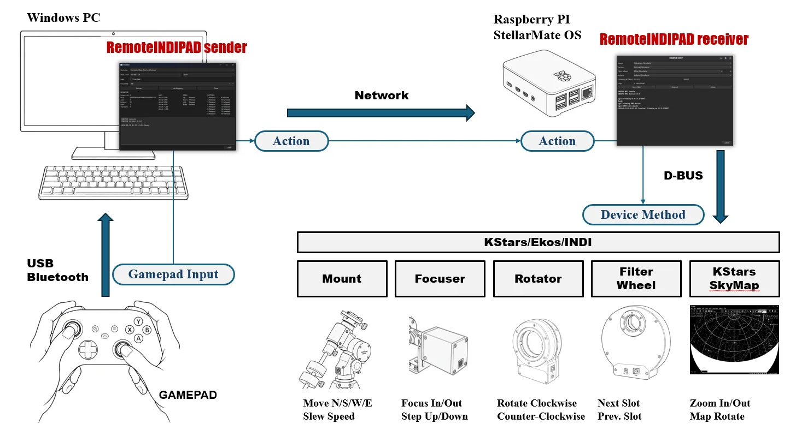
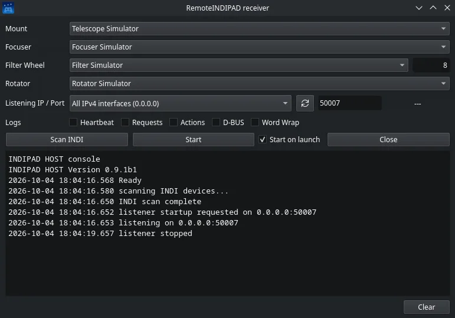
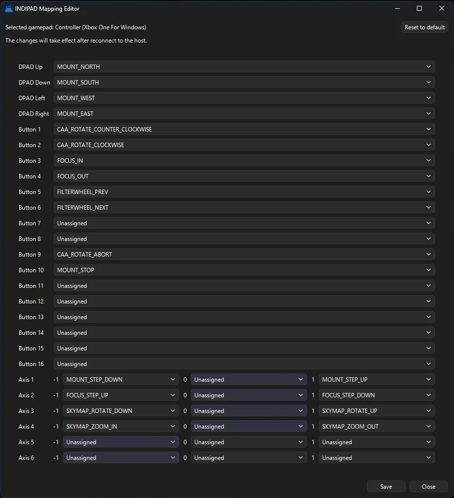
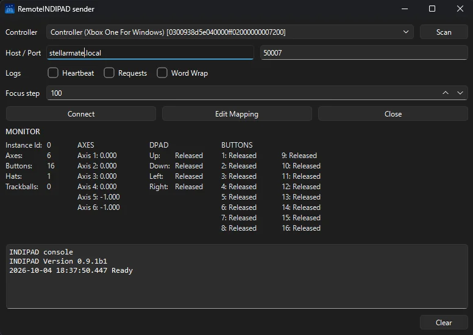

**RemoteINDIPAD** is a new open source tool by INDI community member [jctk](https://github.com/jctk). It lets you plug a gamepad into a Windows PC and use it to control KStars, Ekos and INDI running on another computer on your network, such as a Raspberry Pi with StellarMate OS or an Ubuntu machine.

With a few button presses you can slew the mount, focus, rotate the camera, change filters and move around the KStars sky map, without touching a mouse.

## How it works

RemoteINDIPAD has two programs:

-   **Sender (Windows)** reads the gamepad and turns each button press into an action, such as "move the mount north" or "next filter". It sends these actions over the network.
-   **Receiver (Linux)** runs next to KStars. It receives the actions and carries them out through the KStars D-Bus interface, so it works with whatever devices are loaded in your Ekos profile.



## What you can control

| Device | Actions |
| --- | --- |
| Mount | Move north, south, west and east while the button is held, change slew speed, stop |
| Focuser | Focus in and out, change the step size (5, 10, 50, 100 or 500 steps) |
| Rotator | Rotate clockwise or counterclockwise while the button is held, stop |
| Filter wheel | Next or previous filter slot |
| KStars sky map | Zoom in and out, rotate the map |

The rotator starts with small 1 degree moves and speeds up the longer you hold the button.

So far it has been tested with the Microsoft Xbox Wireless Controller, ELECOM JC-U3712T and 8BitDo Zero 2 gamepads, and with the Juwei 17 mount, GEMINI EAF focuser, ZWO CAA rotator and ToupTek AWF-L filter wheel. Other INDI devices of the same type should work too.

## Download

Get the latest version from the [RemoteINDIPAD releases page](https://github.com/jctk/RemoteINDIPAD/releases). There are three ways to install it:

-   **Ready to run programs** for Windows x64 (sender), and Linux aarch64 and x64 (receiver). Pick `RemoteINDIPAD-windows-x64.zip` for Windows and `RemoteINDIPAD-linux-aarch64.tar.gz` for StellarMate OS on a Raspberry Pi. This is the easiest option.
-   **Python wheels** you install with `pip`, one for the sender and one for the receiver. Use these if the ready to run receiver fails to start on your system.
-   **The source code** from the [GitHub repository](https://github.com/jctk/RemoteINDIPAD). This needs Python 3.10 or later and PySide6, plus pygame on Windows.

On Windows, keep `remote_indipad_sender.exe` and `gamepad_profiles.json` in the same folder.

## Getting started

1.  On your StellarMate or Linux machine, start KStars and your Ekos profile. If you use a mount, unpark it first.
2.  Start the receiver:

    ```bash
    ./remote_indipad_receiver
    ```

    It finds the mount, focuser, filter wheel and rotator in your Ekos profile. If you have more than one device of the same type, pick the one you want from its list. The receiver starts listening on port 50007 by default.

    

3.  Connect the gamepad to your Windows PC by USB or Bluetooth, then start `remote_indipad_sender.exe`.
4.  Select your gamepad under **Controller**, then click **Edit Mapping** to choose what each button, stick and D-pad direction does. The matching entry lights up as you press each button. Click **Save**, then **Close**.

    

5.  Enter the IP address of your StellarMate or Linux machine under **Host** and click **Connect**. Both programs show the connection in their console.

    

6.  Control your equipment with the gamepad.

**Start with slow, small moves and check that everything works as expected.** A mount or rotator that moves the wrong way can damage your equipment, so make sure you can always stop it.

## More information

The [RemoteINDIPAD README](https://github.com/jctk/RemoteINDIPAD#readme) explains every setting, where the settings files are kept, and answers common questions. A Japanese README is also available. RemoteINDIPAD is free and released under the MIT license.
